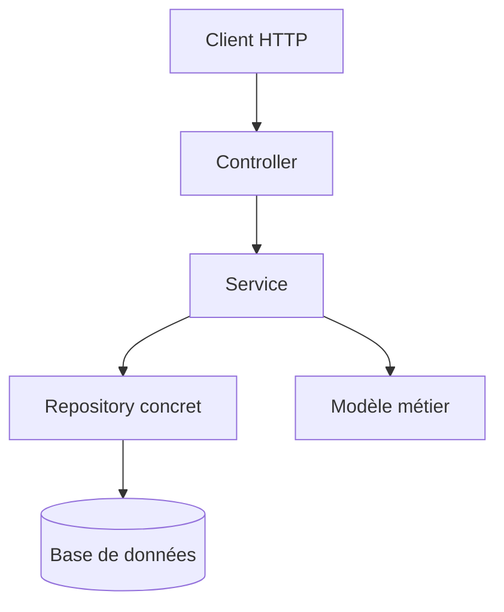
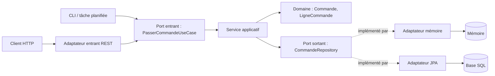
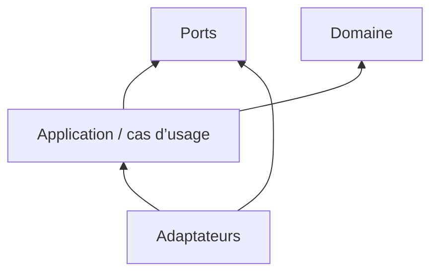
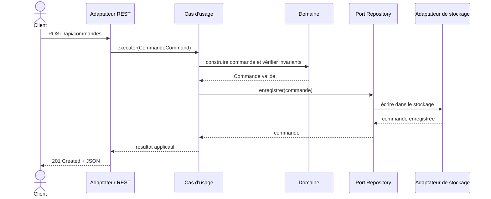
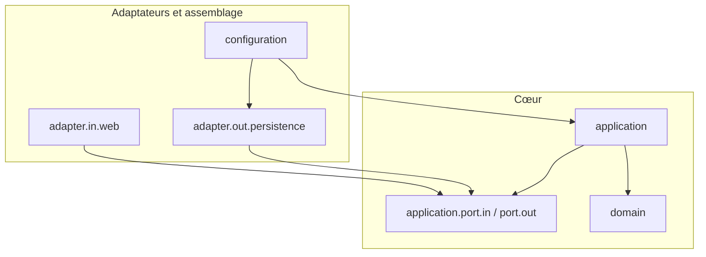

# 8. Diagrammes de l’architecture

Les blocs Mermaid ci-dessous peuvent être copiés dans un visualiseur compatible Mermaid ou dans un README GitHub.

## 8.1 Architecture en couches initiale

**Lecture :** le flux est simple, mais si `Service` dépend d’un repository concret ou si le modèle dépend de JPA, les détails techniques peuvent influencer le métier.

## 8.2 Architecture hexagonale cible

**Important :** les flèches de flux d’exécution et les dépendances de code ne sont pas toujours la même chose. Le service appelle le port sortant, mais le code du port est défini dans le cœur. L’adaptateur dépend de cette abstraction pour l’implémenter.

## 8.3 Dépendances du code

Ce schéma est volontairement simplifié. En pratique, l’adaptateur entrant dépend du port entrant ; l’adaptateur sortant dépend du port sortant. Évitez qu’un adaptateur d’infrastructure soit importé par le domaine.

## 8.4 Diagramme de séquence : créer une commande

## 8.5 Structure de packages

## 8.6 Comment lire un diagramme hexagonal ?

Le dessin peut montrer un hexagone, un cercle ou des rectangles : la forme visuelle importe peu. Demandez plutôt :
1. Où se trouvent les règles métier ?
2. Qui possède les contrats ?
3. Les détails techniques peuvent-ils être remplacés ?
4. Peut-on tester les cas d’usage sans serveur ni base ?
5. Le domaine importe-t-il des packages techniques ?
